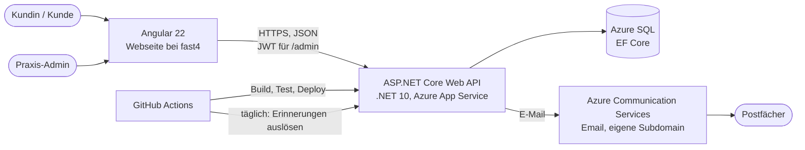
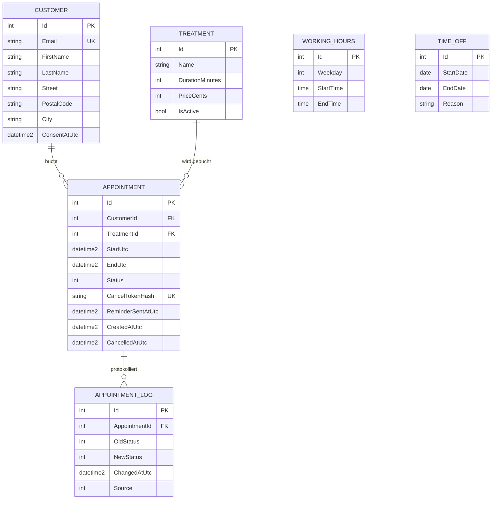
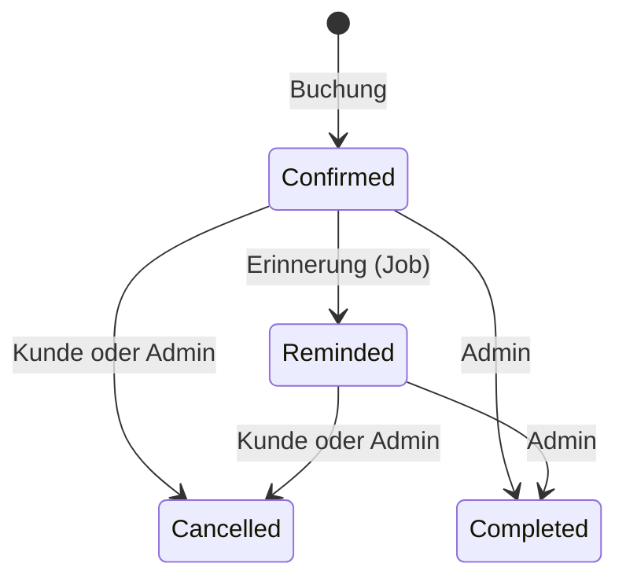

# Terminbuchung für mobile Fußpflege

Online-Terminbuchung mit Bestätigung, Erinnerung und Verwaltungsbereich. Das System ist **produktiv im Einsatz** für eine mobile Fußpflege-Praxis und ersetzt den bisherigen Ablauf per Kontaktformular und Handarbeit.

**Live:** [aylinsfusspflege.de/buchen](https://aylinsfusspflege.de/buchen) (der Verwaltungsbereich ist nicht öffentlich)

> **English summary:** A production booking system for a mobile foot-care practice, built with ASP.NET Core (.NET 10), Azure SQL (EF Core), ASP.NET Core Identity with JWT, and an Angular frontend. It covers a status-based workflow with an audit log, automated reminder and notification emails (Azure Communication Services), role-protected admin endpoints, and CI/CD with tests via GitHub Actions. The README is in German, the code and the API are documented below.

## Funktionen

**Für Kundinnen und Kunden**
- Behandlung wählen, freien Termin sehen, Daten eingeben, buchen. Kein Konto nötig.
- Bestätigungsmail mit Kalenderdatei (`.ics`) und persönlichem Absagelink
- Absage per Link, bis 24 Stunden vor dem Termin
- Automatische Erinnerung am Vortag

**Für die Praxis**
- E-Mail bei jeder Buchung und bei jeder Absage durch Kunden
- Verwaltungsbereich mit Login: Terminliste mit Filter, Verlauf je Termin, Absagen, als erledigt markieren
- Behandlungen pflegen (Dauer, Preis, aktivieren/deaktivieren), Arbeitszeiten und Urlaub festlegen
- Beim Eintragen von Urlaub erscheint die Zahl bereits gebuchter Termine im Zeitraum

## Architektur



**Aufbau der Lösung** (Abhängigkeiten zeigen nach innen):

| Projekt | Inhalt |
|---|---|
| `Fusspflege.Core` | Entitäten, Enums, reine Logik (Slot-Berechnung, Zeitplan, Token), keine Abhängigkeit zu Datenbank oder Framework |
| `Fusspflege.Infrastructure` | EF Core `DbContext` und Konfiguration, Migrationen, Dienste (Buchung, Admin), E-Mail, Hintergrundjobs |
| `Fusspflege.Api` | Controller, DTOs, Authentifizierung (Identity, JWT), Startkonfiguration |
| `Fusspflege.Tests` | xUnit-Tests der Kernlogik |

## Datenmodell



Benutzer, Rollen und Zuordnungen liegen in den Tabellen von ASP.NET Core Identity (`AspNet*`).

**Regeln in der Datenbank, nicht nur im Code:**
- Gefilterter Unique-Index auf `Appointment.StartUtc` (nur für nicht abgesagte Termine): Doppelbuchungen sind auch bei gleichzeitigen Anfragen unmöglich, abgesagte Zeiten werden automatisch wieder frei
- Check-Constraints: gültige Status, Dauer > 0, Start < Ende (Arbeitszeiten, Termine, Urlaub), Preis ≥ 0
- Unique-Constraints auf E-Mail des Kunden und auf den Token-Hash
- Fremdschlüssel ohne Löschweitergabe: Behandlungen und Kunden mit Terminen lassen sich nicht löschen

## Terminstatus als Workflow



Jeder Statuswechsel erzeugt einen Eintrag in `AppointmentLog` mit Zeitpunkt und Auslöser (Kunde, Admin, System). Die erlaubten Übergänge prüft ein Dienst, nicht der Controller.

## Wichtige Entwurfsentscheidungen

| Entscheidung | Begründung |
|---|---|
| Doppelbuchungsschutz in der Datenbank plus erneute Slot-Prüfung im Server | Der Client wird nie vertraut. Bei gleichzeitigen Buchungen entscheidet der Index, die API antwortet mit 409. |
| Zeiten in UTC, Anzeige in Berliner Zeit | Vermeidet Fehler bei der Zeitumstellung. Tests decken Sommer-, Winterzeit und den Umstellungstag ab. |
| Stornotoken nur als SHA-256-Hash gespeichert, Absage per `POST` | Ein Datenbankleck erlaubt keine Absagen. Mail-Scanner, die Links aufrufen, sagen nichts versehentlich ab. |
| Erinnerungen idempotent per atomarem `UPDATE ... WHERE Status = Confirmed` | Auch bei doppeltem oder parallelem Lauf geht pro Termin genau eine Erinnerung raus. Schlägt der Versand fehl, wird zurückgesetzt. |
| Erinnerungsjob einmal täglich, zusätzlich von GitHub Actions auslösbar | Ein häufiger Takt hält die Serverless-Datenbank wach und verbraucht das Gratis-Kontingent. Der kostenlose App-Tarif schläft zudem. |
| E-Mail hinter einem Interface (`IEmailSender`) | Entwicklung schreibt Mails ins Log, Produktion nutzt Azure. Ein Wechsel des Anbieters ändert keinen Fachcode. |
| Mailfehler brechen Buchung oder Absage nicht ab | Der Termin ist schon gespeichert. Fehler werden protokolliert. |
| Identity mit eigenem Login-Endpunkt, JWT, keine Registrierung | Es gibt nur Admins. Fünf Fehlversuche sperren das Konto für 15 Minuten. |
| Geheimnisse nur in User Secrets bzw. Azure-Einstellungen | Nichts davon im Repository. Die API startet ohne Signaturschlüssel absichtlich nicht. |
| Behandlungen werden deaktiviert statt gelöscht | Bestehende Termine behalten ihren Bezug, die Historie bleibt vollständig. |
| Wochenplanung wird als Ganzes validiert und in einer Transaktion ersetzt | Entweder gilt der neue Plan komplett, oder der alte bleibt. |

## Technik

- **Backend:** C#, .NET 10, ASP.NET Core Web API, Entity Framework Core (Migrationen), SQL Server / Azure SQL
- **Authentifizierung:** ASP.NET Core Identity, JWT (Bearer), rollenbasierter Zugriff
- **E-Mail:** Azure Communication Services Email, `.ics`-Kalenderdateien
- **Frontend:** Angular 22 (Standalone-Komponenten, Signals, Reactive Forms), eigenes CSS ([Repository](HIER-LINK-ZUM-FRONTEND-REPOSITORY))
- **Betrieb:** Azure App Service (Linux), Azure SQL, GitHub Actions (Anmeldung per OpenID Connect)
- **Tests:** xUnit

## API-Überblick

| Methode | Pfad | Zugriff | Zweck |
|---|---|---|---|
| GET | `/api/treatments` | öffentlich | buchbare Behandlungen |
| GET | `/api/slots?treatmentId=&date=` | öffentlich | freie Zeiten eines Tages |
| POST | `/api/appointments` | öffentlich | Termin buchen |
| GET | `/api/appointments/by-token/{token}` | Token | Termin ansehen |
| POST | `/api/appointments/by-token/{token}/cancel` | Token | Termin absagen |
| POST | `/api/auth/login` | öffentlich | Anmeldung, liefert JWT |
| POST | `/api/internal/run-reminders` | API-Schlüssel | Erinnerungslauf auslösen |
| GET | `/api/admin/appointments`, `/{id}/log` | Admin | Terminliste (Filter), Verlauf |
| POST | `/api/admin/appointments/{id}/cancel`, `/complete` | Admin | Status ändern |
| GET, POST, PUT | `/api/admin/treatments` | Admin | Behandlungen verwalten |
| GET, PUT | `/api/admin/working-hours` | Admin | Arbeitszeiten |
| GET, POST, DELETE | `/api/admin/time-off` | Admin | Urlaub und freie Tage |

Eine Postman-Sammlung liegt unter [`docs/postman`](docs/postman).

## Lokal starten

Voraussetzungen: .NET 10 SDK und eine SQL-Server-Datenbank (LocalDB, Docker oder Azure SQL).

```powershell
# Geheimnisse lokal speichern (landen nicht im Repository)
dotnet user-secrets set "ConnectionStrings:Default" "<Verbindungszeichenfolge>" --project src/Fusspflege.Api
dotnet user-secrets set "Jwt:Key" "<zufälliger Schlüssel, mindestens 32 Zeichen>" --project src/Fusspflege.Api
dotnet user-secrets set "Admin:Email" "<Admin-E-Mail>" --project src/Fusspflege.Api
dotnet user-secrets set "Admin:Password" "<Passwort, mindestens 12 Zeichen>" --project src/Fusspflege.Api

# Datenbank anlegen und starten
dotnet ef database update -p src/Fusspflege.Infrastructure -s src/Fusspflege.Api
dotnet run --project src/Fusspflege.Api
```

In der Entwicklung werden Beispieldaten (Behandlungen, Arbeitszeiten) eingespielt, und E-Mails erscheinen im Log statt im Postfach. Swagger-Oberfläche: `/swagger`.

## Tests und Deployment

```powershell
dotnet test
```

15 Tests prüfen die Kernlogik: Slot-Berechnung (Arbeitszeiten, Urlaub, Pufferzeiten, bestehende Termine, Zeitumstellung), Umrechnung von Berliner Tagen nach UTC und den Zeitplan der Erinnerungen.

Jeder Push auf `master` startet einen GitHub-Actions-Workflow: bauen, testen, nur bei Erfolg nach Azure veröffentlichen. Ein zweiter Workflow löst täglich den Erinnerungslauf aus.

## Bekannte Grenzen und nächste Schritte

- Kein Rate Limiting für die öffentlichen Endpunkte (Schutz vor Spam-Buchungen)
- Gleichzeitige Änderungen am selben Termin durch Admin und Kunde: der Letzte gewinnt (Zeilenversion fehlt)
- Mailversand ohne Warteschlange (Outbox) mit automatischen Wiederholungen
- Geheimnisse liegen in Azure-App-Einstellungen, Key Vault wäre der nächste Schritt
- Nur automatisierte Tests der Kernlogik, keine Integrationstests gegen die API
- Kostenloser App-Tarif: der erste Aufruf nach Leerlauf braucht einige Sekunden

## Screenshots

| Buchung | Verwaltungsbereich | Bestätigungsmail |
|---|---|---|
|  |  |  |
